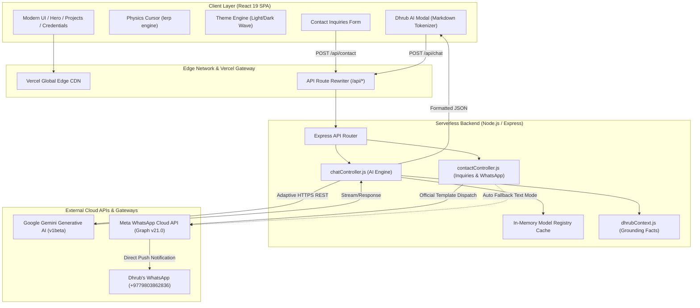
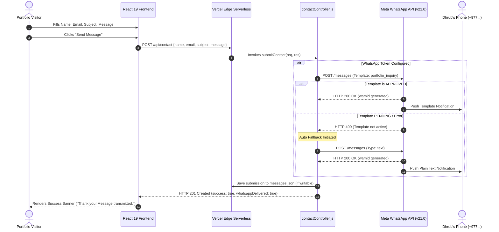
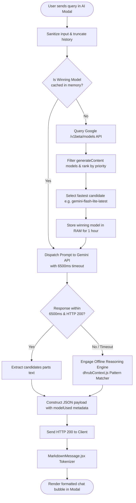

# Dhrub Pandit — Full-Stack & AI Engineer Portfolio 🚀

[](https://github.com/dhrub4545/portfolio)
[](https://www.audexai.in)
[](https://github.com/dhrub4545)
[](https://developers.facebook.com)
[](https://ai.google.dev)
[](https://nec.gov.np)

> An enterprise-grade, high-performance developer portfolio built with a modern decoupled architecture: a **React 19** Single Page Application frontend paired with an asynchronous **Node.js / Express** REST API on **Vercel Serverless**. Integrated with the official **Meta WhatsApp Business Cloud API** for instant lead alerts and an **Adaptive Google Gemini AI** reasoning assistant.

---

## 📑 Table of Contents

- [System Architecture](#-system-architecture)
- [Key Engineering Capabilities](#-key-engineering-capabilities)
- [Core Technical Methods & Solutions](#-core-technical-methods--solutions)
  - [1. Meta WhatsApp Cloud API Dual-Mode Dispatch](#1-meta-whatsapp-cloud-api-dual-mode-dispatch)
  - [2. Adaptive Gemini AI Engine & Fallback Pipeline](#2-adaptive-gemini-ai-engine--fallback-pipeline)
  - [3. Zero-Dependency Markdown State Machine (`MarkdownMessage.jsx`)](#3-zero-dependency-markdown-state-machine-markdownmessagejsx)
  - [4. Physics-Based Liquid Cursor & Reactive Glassmorphism](#4-physics-based-liquid-cursor--reactive-glassmorphism)
- [System Flowcharts](#-system-flowcharts)
  - [Contact Inquiry & WhatsApp Delivery Pipeline](#contact-inquiry--whatsapp-delivery-pipeline)
  - [AI Assistant Request Lifecycle & Dynamic Model Discovery](#ai-assistant-request-lifecycle--dynamic-model-discovery)
- [Project Directory Structure](#-project-directory-structure)
- [REST API Reference](#-rest-api-reference)
- [Environment Variables & Configuration](#-environment-variables--configuration)
- [Local Development & Deployment](#-local-development--deployment)
- [Engineering Credentials & Author](#-engineering-credentials--author)

---

## 🏛️ System Architecture

The project employs a decoupled monorepo architecture with specialized Git subtrees for automated CI/CD deployment onto Vercel Edge networks.



---

## ✨ Key Engineering Capabilities

* **Adaptive Dhrub AI Conversational Modal**:
  * Backed by dynamic real-time model discovery querying Google's Gemini models.
  * Auto-selects low-latency, high-throughput models (e.g., `gemini-flash-lite-latest`, `gemini-2.5-flash`).
  * Structured system prompt grounding prevents hallucination and guarantees sub-3-second responses.
* **Instant WhatsApp Contact Dispatching**:
  * Real-time automated notification delivered straight to Dhrub's mobile device via Meta's official WhatsApp Business Cloud API.
  * Dual-mode redundancy: Official Meta Message Template (`portfolio_inquiry`) with automatic text fallback.
* **Physics-Based Custom Cursor**:
  * Linear interpolation (`lerp`) cursor trailing with physics-inspired velocity, magnetic element expansion, and touch-screen suppression.
* **Sloshing Liquid Theme Engine**:
  * Dark (`#0d0d12`) / Light (`#f8fafc`) theme switcher using SVG clip-path wave animations and persistent state.
* **Filterable Featured Projects Grid**:
  * Dynamic filtering across Full Stack & AI, Web Platforms, and Machine Learning.
  * Showcases flagship projects including **AUDEX AI** (Enterprise LLM Spend Auditing), **MovieTV** (cinematic streaming with AES-128 HLS decryption), **fshare** (WebRTC P2P DataChannels), and **LLM Quiz Generator**.
* **Verified Academic & Professional Credentials**:
  * Interactive high-resolution credential viewer for the official **RRIT / VTU Degree Transcript (8.94 CGPA)** and **Karunadu Technologies Machine Learning Internship Certificate**.

---

## 🛠️ Core Technical Methods & Solutions

### 1. Meta WhatsApp Cloud API Dual-Mode Dispatch

**The Challenge:**
In serverless environments (AWS Lambda / Vercel), background promises are forcefully frozen upon execution of `res.json()`. Furthermore, Meta WhatsApp Business Cloud API enforces a strict 24-hour customer service window for plain-text messages; contacting a recipient outside that window requires an approved Meta Message Template.

**The Solution:**
* **Serverless Promise Awaiting**: All WhatsApp dispatches are fully awaited inside [`contactController.js`](file:///c:/Users/pandi/OneDrive/Desktop/github/portfolio/backend/src/controllers/contactController.js) before the HTTP response terminates.
* **Dual-Mode Redundancy**:
  1. **Primary Template Mode**: Dispatches an official Meta Message Template (`portfolio_inquiry`, `UTILITY` category) parameterized with the visitor's Name `{{1}}`, Email `{{2}}`, Subject `{{3}}`, and Message body `{{4}}`.
  2. **Automated Fallback Mode**: If Meta reports that the template is still pending review or translation (`#132001`), the controller catches the error and instantly resubmits as an authorized plain text WhatsApp notification (`type: 'text'`).
* **Permanent Token Authentication**: Authenticates against Meta Graph API `v21.0` via a long-lived System User Access Token with `whatsapp_business_messaging` permissions.

### 2. Adaptive Gemini AI Engine & Fallback Pipeline

**The Challenge:**
Hardcoding LLM model identifiers (such as `gemini-pro` or deprecated checkpoints) causes sudden 404 outages when APIs migrate. Additionally, Vercel Hobby functions impose a strict 10-second timeout.

**The Solution:**
* **Dynamic Model Discovery**: Queries `https://generativelanguage.googleapis.com/v1beta/models` to discover currently supported models.
* **Priority Tiering**: Filters and ranks models by speed and latency:
  `['gemini-flash-lite-latest', 'gemini-2.5-flash', 'gemini-3.5-flash', 'gemini-1.5-flash']`.
* **Execution Budget Guard**: HTTP requests enforce an explicit `AbortController` timeout of `6500ms`. If the LLM does not respond within this window, the controller falls back to a deterministic, offline keyword-matching reasoning engine.
* **In-Memory Model Caching**: Discovered winning models are cached for 1 hour to eliminate discovery overhead on warm serverless invocations.

### 3. Zero-Dependency Markdown State Machine (`MarkdownMessage.jsx`)

**The Challenge:**
Rendering rich LLM responses (bold headings, code blocks, bullet points, hyperlinks) using heavy third-party markdown packages introduces bundle bloat and vulnerability vectors.

**The Solution:**
A lightweight, zero-dependency custom parser ([`MarkdownMessage.jsx`](file:///c:/Users/pandi/OneDrive/Desktop/github/portfolio/frontend/src/components/MarkdownMessage.jsx)):
* Evaluates lines sequentially through a stateful tokenization loop.
* Identifies fenced code blocks (```` ``` ````), headings (`#`, `##`, `###`), blockquotes (`>`), numbered lists (`1.`), and bullet items (`*`, `-`).
* Tokenizes inline syntax: `**bold**`, `*italic*`, `` `inline code` ``, and `[label](url)` links with safe target handling (`target="_blank" rel="noopener noreferrer"`).
* Protects against malicious injection while ensuring fast, readable UI rendering.

### 4. Physics-Based Liquid Cursor & Reactive Glassmorphism

* Cursor position is computed using linear interpolation:
  $$P_{current} = P_{current} + (P_{target} - P_{current}) \times \alpha \quad (\alpha = 0.18)$$
* Automatically senses touch-enabled hardware (`window.matchMedia('(pointer: coarse)')`) to disable synthetic cursors on mobile and tablet displays.
* Clean glassmorphic styling utilizing CSS variables (`--bg-primary`, `--accent-primary`, `--border-color`) to guarantee dark/light mode legibility.

---

## 📊 System Flowcharts

### Contact Inquiry & WhatsApp Delivery Pipeline

The sequence diagram below illustrates the end-to-end lifecycle when a visitor submits an inquiry on the portfolio:



---

### AI Assistant Request Lifecycle & Dynamic Model Discovery

The flowchart below demonstrates the adaptive intelligence pipeline powering the conversational assistant modal:



---

## 📂 Project Directory Structure

```
portfolio/
├── backend/
│   ├── assets/                      # Official credentials, transcripts & Resume PDF
│   ├── data/                        # JSON persistent logs (messages.json, stats.json)
│   ├── src/
│   │   ├── controllers/
│   │   │   ├── chatController.js    # Adaptive Gemini AI & offline heuristic reasoning
│   │   │   └── contactController.js # Contact form handler, WhatsApp dispatch & analytics
│   │   ├── data/
│   │   │   └── dhrubContext.js      # Comprehensive knowledge base & credentials context
│   │   ├── routes/
│   │   │   └── api.js               # REST routes (/profile, /chat, /contact, /stats, /resume)
│   │   └── server.js                # Express app bootstrap, CORS, rate limits & Vercel export
│   ├── .env.example                 # Template for required environment variables
│   └── package.json                 # Backend dependencies (express, cors, dotenv)
│
├── frontend/
│   ├── public/
│   │   └── assets/                  # High-res profile photos, certificates & downloadable PDF
│   ├── src/
│   │   ├── components/
│   │   │   ├── Navbar.jsx           # Fluid navigation bar with active section tracking
│   │   │   ├── Hero.jsx             # Headline, interactive AI prompt chips, 3D card
│   │   │   ├── About.jsx            # Engineering narrative, VTU/NEC licensure badges, stats
│   │   │   ├── Experience.jsx       # Karunadu Technologies timeline & certificate zoom
│   │   │   ├── Projects.jsx         # Filterable projects grid (AUDEX AI, MovieTV, fshare)
│   │   │   ├── SkillsEdu.jsx        # Categorized skills matrix & VTU degree showcase
│   │   │   ├── Contact.jsx          # Clean direct contact form & WhatsApp direct link
│   │   │   ├── Footer.jsx           # Real-time analytics counter & social links
│   │   │   ├── LiquidCursor.jsx     # Linear interpolation physics cursor
│   │   │   ├── ScrollToTop.jsx      # Launching rocket smooth-scroll button
│   │   │   ├── ThemeToggle.jsx      # Sloshing liquid wave theme switcher
│   │   │   ├── AiAssistantModal.jsx # Interactive Dhrub AI reasoning chat modal
│   │   │   ├── MarkdownMessage.jsx  # Zero-dependency Markdown state machine parser
│   │   │   ├── ResumeModal.jsx      # Interactive PDF resume previewer
│   │   │   └── CertificateModal.jsx # Modal viewer for degree transcript & certificates
│   │   ├── data/
│   │   │   └── portfolioData.js     # Client-side cache of skills, projects, and contact info
│   │   ├── styles/
│   │   │   └── portfolio.css        # Comprehensive design system, glassmorphism, responsive rules
│   │   ├── App.jsx                  # Main application state and modal coordinator
│   │   └── main.jsx                 # Vite / React 19 entry point
│   ├── index.html                   # HTML5 shell, SEO meta tags & web fonts
│   ├── vite.config.js               # Vite build config with /api development proxy
│   └── package.json                 # Frontend dependencies (react, lucide-react, vite)
│
├── .gitignore                       # Ignored build artifacts, logs & secret environment files
├── package.json                     # Monorepo root script runner (concurrent dev / install)
└── README.md                        # Master project documentation
```

---

## 📡 REST API Reference

All backend endpoints are accessible under the `/api` prefix.

| Method | Endpoint | Description | Request Payload | Response Sample |
| :--- | :--- | :--- | :--- | :--- |
| `GET` | `/api/health` | Backend health & uptime check | None | `{ "status": "ok", "uptime": 1284 }` |
| `GET` | `/api/profile` | Complete structured resume data | None | Structured JSON profile object |
| `POST` | `/api/chat` | AI Assistant query processing | `{"message": "Tell me about AUDEX AI", "history": []}` | `{"reply": "...", "modelUsed": "gemini-flash-lite-latest"}` |
| `GET` | `/api/chat/status` | Diagnostics for Gemini models | None | `{"geminiKeyConfigured": true, "activeModel": "..."}` |
| `GET` | `/api/chat/test` | Live test of Google Gemini API | `?model=gemini-flash-lite-latest` | `{"googleConnected": true, "reply": "..."}` |
| `POST` | `/api/contact` | Ingestion & WhatsApp dispatch | `{"name": "...", "email": "...", "subject": "...", "message": "..."}` | `{"success": true, "whatsappDelivered": true}` |
| `GET` | `/api/contact/whatsapp-test` | WhatsApp dispatch test | None | `{"configured": true, "mode": "template", "metaHttpCode": 200}` |
| `GET` | `/api/stats` | Pageview & repository analytics | None | `{"pageViews": 1420, "githubRepos": 18}` |
| `POST` | `/api/stats/view` | Increments page view counter | None | `{"pageViews": 1421}` |
| `GET` | `/api/resume/download` | Downloads official PDF resume | None | Binary PDF Stream (`Dhrub_ResumeNP.pdf`) |

---

## 🔐 Environment Variables & Configuration

Create a `.env` file inside `backend/` for local development or configure these variables in the **Vercel Project Settings**:

| Variable | Required | Description | Example Value |
| :--- | :---: | :--- | :--- |
| `PORT` | Optional | Local Express server port (default: 5000) | `5000` |
| `GEMINI_API_KEY` | Recommended | Google Gemini AI API Key | `AIzaSy...` |
| `META_WHATSAPP_TOKEN` | Recommended | Permanent Meta System User Access Token | `EAAShf...` |
| `META_PHONE_NUMBER_ID` | Recommended | Meta WhatsApp Business Test/Live Phone Number ID | `1487993791054252` |
| `WHATSAPP_PHONE` | Recommended | Dhrub's recipient phone number (country code + number) | `9779803862836` |

> **Note on Vercel Deployment:** Whenever environment variables are updated in Vercel, trigger a **Redeploy** on the latest deployment for changes to take effect in the serverless cache.

---

## 💻 Local Development & Deployment

### 1. Prerequisites
* **Node.js**: v18.0.0 or higher
* **npm**: v9.0.0 or higher
* **Git**: Installed and configured

### 2. Installation
```bash
# Clone the repository
git clone https://github.com/dhrub4545/portfolio.git
cd portfolio

# Install all monorepo dependencies concurrently
npm run install:all
```

### 3. Run Development Server
```bash
# Runs frontend (port 3000) and backend (port 5000) concurrently:
npm run dev
```

* **Frontend Application**: [http://localhost:3000](http://localhost:3000)
* **Backend REST API**: [http://localhost:5000/api](http://localhost:5000/api)
* **Health Check**: [http://localhost:5000/api/health](http://localhost:5000/api/health)

### 4. Git Subtree Deployment Workflow
This monorepo pushes code to both the unified repository and its decoupled subtree mirrors:
```bash
# Push main monorepo
git push origin main

# Deploy Frontend Subtree to Vercel production
git subtree push --prefix frontend https://github.com/dhrub4545/portfolio_frontend.git main

# Deploy Backend Subtree to Vercel production
git subtree push --prefix backend https://github.com/dhrub4545/portfolio_backend.git main
```

---

## 👨‍💻 Engineering Credentials & Author

**Dhrub Pandit**  
*Full-Stack & AI Engineer | SaaS Founder*

* **Licensure**: **Nepal Engineering Council (NEC)** Licensed Computer Science Engineer
* **Degree**: Bachelor of Engineering (B.E.) in Computer Science & Engineering
  * **Institution**: R.R. Institute of Technology (RRIT), Visvesvaraya Technological University (VTU), Bengaluru, India
  * **Academic Merit**: **8.94 / 10 CGPA** (First Class with Distinction)
* **Experience**: Former Python Programming & Applied Machine Learning Intern at **Karunadu Technologies Private Limited**
* **Flagship SaaS**: Founder & Creator of [AUDEX AI](https://www.audexai.in) — Enterprise LLM Cost Optimization & Spend Auditing
* **Contact Channels**:
  * **Email**: [panditdhrub0@gmail.com](mailto:panditdhrub0@gmail.com)
  * **WhatsApp / Direct**: [+977 9803862836](https://wa.me/9779803862836)
  * **GitHub**: [@dhrub4545](https://github.com/dhrub4545)
  * **LinkedIn**: [Connect on LinkedIn](https://linkedin.com)

---

<div align="center">
  <sub>Built with engineering precision by Dhrub Pandit. Distributed under the MIT License.</sub>
</div>
